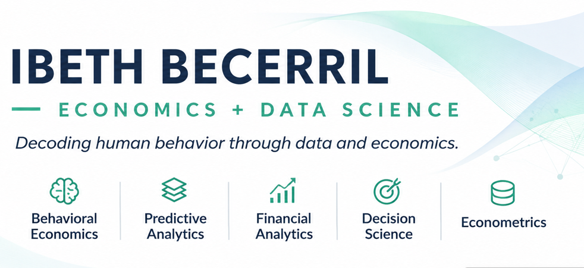

  

---

## ABOUT ME | SOBRE MÍ

**EN**

Economist with a Master's degree in Finance and 12 years of experience in financial markets, investment analysis and infrastructure projects. Combining economic expertise with Data Science, statistical modeling and machine learning to generate actionable insights.

Interested in Behavioral Economics and understanding how people make economic and financial decisions.

**ES**

Economista con Maestría en Finanzas y 12 años de experiencia en mercados financieros, análisis de inversiones e infraestructura. Integro mi experiencia económica y financiera con Ciencia de Datos para generar insights y facilitar decisiones estratégicas.

Interesada en Behavioral Economics y el análisis de los factores que influyen en las decisiones económicas y financieras.

---

## WHAT DRIVES ME

---

## TECH STACK

 

---

## AREAS OF INTEREST

- Behavioral Economics & Behavioral Data Science
- Machine Learning & Predictive Modeling
- Financial and Investment Analytics
- Time Series Analysis & Forecasting
- Statistical Analysis & Econometrics
- Natural Language Processing

---

## LET'S CONNECT

   
  <i>Economics + Data Science = Understanding Human Behavior</i>

